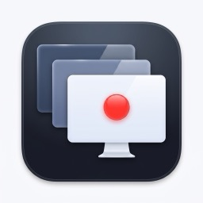

# Multi Screen Recorder


A reliable multi-source screen and audio recorder for macOS. It
captures every screen, camera and audio source, never loses a recording,
and keeps going when screens, resolutions or audio sources change.

**Status:** in development. Builds record every screen, camera and
audio source. The app shows its settings and the ready check and records with
Start, and the command line lists screens, cameras and audio inputs, runs the
ready check, records and manages the settings. An audio input with its
own clock is resampled continuously to stay with the screen files
(clock drift correction).

## What it does

- **One click, nothing missed.** Start the app, check what will be
  recorded, click Start: every screen, every camera and every
  audio source is recorded until you click the Dock icon, then Stop. A check before you
  start, warnings when disk space runs low, files that stay readable
  after a crash.
- **Every screen, as screens come and go.** Each screen gets its own
  video file. Plugging in a projector, removing it, closing or opening
  the laptop's lid, or switching mirroring does not stop the recording.
- **Every camera in its own file.** All real cameras by default, the
  built-in one and those on a cable; or none, only
  the default camera, or all of them, virtual and iPhone cameras
  (Continuity Camera, Desk View) too. Each is
  recorded like a screen, in its largest format that still delivers
  30 frames per second and fits the recording resolution.
- **Every audio source in its own file.** No audio, the default
  microphone, the wired or all audio inputs, plus the system audio if
  you want it; each channel its own track. Or audio only: the
  recording resolution None records no screen and no camera.
- **In sync after hours.** The drift of each audio source's own clock
  is corrected, so audio and screen tracks are still in sync after
  hours.
- **Auto mode.** On by default: every screen at Native, the wired audio
  inputs and the default microphone, every real camera, safe to sort
  out in the editor at the expense of disk space. Off, you choose
  resolution, audio mode and camera mode.
- **Edit-ready files.**
  - Timecode in every file, so an editor puts all of them on one
    timeline in place.
  - Named by source: file names, reel names and track names such as
    `Screen 1 - DELL P3421W` or `Audio 2 - Razer Seiren V3 Mini`.
  - A constant 30 frames per second and a fixed frame size per file,
    at a recording resolution you choose (Native, 4K, 1440p, 1200p,
    1080p or 720p, or None for audio only), only ever scaled down.
    Native is the size macOS shows as "looks like" for the screen, not
    the size it is drawn at.
  - A ready-made [OpenTimelineIO](http://opentimeline.io/) timeline in every recording folder
    (`<folder name>.otio`): a video track per screen, an audio track per
    channel with the channels of one input linked, the system audio, a
    marker per screen or audio change. The OTIO file can be imported in DaVinci Resolve, [Kdenlive](https://docs.kdenlive.org/en/user_interface/menu/file_menu.html#opentimelineio-import) and others.
  - Two guide tracks in every video file (screen and camera), the audio inputs and the
    system audio, for playback and for syncing by waveform with a
    separate recording.
- **Scriptable.** Everything also works from the command line.
- **Nothing leaves your Mac.** The app makes no network connections.

It runs on macOS 26 and later, on Apple silicon. The homepage is
<https://multiscreenrecorder.schapiro.org>.

## Tester guide

Multi Screen Recorder is in testing. Thank you for trying it!

### Requirements

A Mac with Apple silicon (M1 or later) and macOS 26 or later.

### Installation

1. Download the zip from the
   [latest release](https://github.com/schlomo/multi-screen-recorder-macos/releases/latest)
   (or, to try a change before it is merged, the snapshot release of a
   pull request, `Snapshot PR #<n>`, from the
   [releases](https://github.com/schlomo/multi-screen-recorder-macos/releases)).
2. Unzip it and move `Multi Screen Recorder.app` to `/Applications`.
3. Start it from Finder. The app is signed with the project's own
   certificate, not by an Apple-registered developer, so macOS refuses
   to open it the first time. Open System Settings › Privacy & Security,
   scroll to "Multi Screen Recorder was blocked", click **Open Anyway**
   and confirm.
4. Grant the permissions when macOS asks: **Screen & System Audio
   Recording** (for the screens and the system audio; not asked for
   audio only without the system audio),
   **Microphone** (asked only when a microphone is recorded: not on a
   Mac without an audio input, nor with the audio mode None) and
   **Camera** (asked only when a camera is recorded: not on a Mac
   without a camera, nor with the camera mode None). All are in
   System Settings › Privacy & Security.
   A microphone permission allowed there, not in the prompt, counts
   only after you quit the app and start it again; if the screen
   recording permission still shows as missing, do the same.

Every build is signed with the same certificate, so a newer build
installed over an older one should keep its permissions; this is not
confirmed yet.

### Known limits

- **CPU:** recording takes about a third of one CPU core, with two
  screens, the system audio and three microphones (steady use from
  30 s on, over 3 minutes on the owner's Mac, 2026-11-18).
- **Clock drift:** some USB audio devices drift against the video, by
  up to about 0.4 s per hour. The recorder corrects it by resampling
  their sound. In a one-hour recording on the owner's Mac, two
  microphones' files kept the same lag to each other within 1 ms by
  room sound, where uncorrected they would have moved about 0.4 s
  apart.
- **USB docks:** plugging a USB device into a dock while recording can
  cause a few seconds of silence or repeated audio in the USB audio
  inputs.
- **Cameras:** recording from a real camera is not yet checked on real
  hardware; the tests use a stand-in camera.

### What to test and send

1. Make one recording of about an hour with your normal setup: your
   usual screens, microphone or headset, and dock. Start the app, take
   the screenshot asked for below, and click Start; at the end, click the app's Dock icon, then Stop: the
   files are finished and the recording folder opens in Finder.
2. During it, change things as you normally would: plug in or unplug a
   screen or headset, switch audio inputs, close and open the lid.
3. If you use a video editor (Final Cut Pro, DaVinci Resolve,
   Premiere Pro…), try putting the files together there.

Then send the person who asked you to test:

- a screenshot of the app's window before you click Start: it shows
  the version, your screens and audio inputs and the ready check.
  Press Shift-Command-4, then Space, then click the window;
  the screenshot lands on your desktop;
- `recording.json` and `recording.log` from the recording folder of every recording you
  made, the ones that went fine too: they show how far each audio input
  drifted, how much the recorder corrected, and everything that happened. The recording folders are in
  the output folder the app's window shows, by default
  `~/Movies/Multi Screen Recorder/`, one folder per recording;
- a few sentences: where installing or the first start was confusing
  or got stuck; whether the files worked in your editor; anything odd,
  such as fan noise, battery drain, gaps or echoes in the audio, or a
  missing screen.

Please don't send the recordings themselves: they show whatever was
on your screens. The window's screenshot names your screens and audio
inputs and shows your output folder. `recording.json` holds what the
[problem report form](https://github.com/schlomo/multi-screen-recorder-macos/issues/new?template=problem-report.yml)
lists: the names of your screens and audio inputs and the identifiers
macOS gives them (which can hold a device's serial number), the start
and end time with your time zone, and folder paths that can contain
your Mac's user name. Remove or replace anything you don't want to
share.

If something clearly breaks (a crash, a lost or broken file), please
also report it as below.

### Reporting a problem

When a recording had problems, the app says so the next time it
starts: **Report a problem** opens the problem report form in your
browser with the version and what went wrong filled in, and shows that
recording's `recording.json` and `recording.log` in Finder. `msr record`
ends such a recording's summary with the same link (`Report it:`) and
the files to attach (`Attach:`). Otherwise use the
[problem report form](https://github.com/schlomo/multi-screen-recorder-macos/issues/new?template=problem-report.yml)
(a GitHub account is needed). It asks for the output of `msr version`
(see "Command line" below; About Multi Screen Recorder in the app's
menu shows the same), what happened and what you expected, and the
recording's `recording.json`. Please also drag the recording's
`recording.json` and `recording.log` from its recording folder into the
issue: `recording.log` is the recording log, every event and problem of
the recording with the full error macOS gave, and what the app did and
read meanwhile, one line each. Issues are public: the form says what
`recording.json` contains, and `recording.log` names the same screens,
cameras and audio inputs; a camera's name can hold a person's name (a
Continuity Camera's often does), and `cameraUniqueID` identifies the
camera. Open both in TextEdit and remove what you don't want to share.
The recordings themselves show what the cameras saw; attach none. Nothing is sent automatically: you see the files and attach
them yourself.

## Usage

Start the app from Finder: its window shows the app's icon, version
and homepage, then what will be recorded (one
table: the screens, with what each looks like, the size it is drawn at
and the size it records at (dimmed and not numbered at the recording
resolution None, which records no screen), then the cameras, each with the size it
records at, then the audio sources, the system audio
first and the inputs by number, then the ones not recorded, dimmed and
with their reason (such as "(virtual)"); each row with the most disk space it can write
per hour, "GB/h max", usually more than it writes; the total as the
last row; below it the space the required hours need and the free
space; the output folder, a link that opens it in Finder), then the switch "Auto" (on, the three sliders are grayed out and show Native, Wired and All real; off,
they are enabled and show the recording resolution (None, which records
audio only, then 720p up to Native) and the audio mode: None, Default
microphone, Wired or All, with a note under it on Bluetooth and virtual
microphones, and the camera mode: None, Default camera, All real or All,
with a note under it on virtual and iPhone cameras), system audio, the output folder and the ready check:
"Ready to record" when every item passes, otherwise each item with a
fix for each failing one; a recording that would record neither a
screen nor any audio does not pass. Every change is saved at once; the ready check runs again after each change,
when you come back to the app, when a screen is plugged in, removed
or changed, when an audio device is plugged in or removed, when the
default audio input changes, and on "Check again". Cancel, in the
lower right corner beside Start, quits without recording.

Click Start: the window closes; the Dock icon shows a "!" badge when
the disk runs low, a screen shows another screen's picture or
something went wrong. Click the Dock icon or quit to open the status
window: each screen, camera and audio source with its files, the data written
and its state, each audio source's level meter (red from −1 dBFS) and,
where macOS lets it be set, a slider for an audio input's input volume
(it changes that input's volume for every app on the Mac, and stays as
set after Stop), the time recorded (`h:mm:ss`, every second), data and
free space, the CPU use of Multi Screen Recorder itself (encoding and
capture also run in macOS's own processes, which it does not include),
and any problems in red, with a line naming the two files a report
needs. Stop there finalizes the files, opens the
recording folder in Finder and quits; Continue keeps recording. The
recording folder holds a video file per screen, a new one each time a
screen comes back or changes its frame size, an audio file per audio
source (a microphone unplugged and plugged in again gets a new one; one
that delivers only silence of exact zeros for 10 s, such as the
MacBook's microphone with its lid closed or a muted microphone, gets no
file until its sound returns, and its state says `no audio`),
`recording.json`, which lists every file, what happened and every
problem, and says how the recording ended, and `recording.log`, the
recording log: every event and problem with the full error, and what
the app did meanwhile, one line each.

### Command line

The app's own executable is the command line. Link it into a folder on
your `PATH`, for example `~/bin` if that is on yours:

```sh
ln -s "/Applications/Multi Screen Recorder.app/Contents/MacOS/msr" ~/bin/msr
```

Started through the link, `msr` re-executes itself from inside the app,
so it shows the app's version and runs with its signature.

| Command | Does |
|---|---|
| `msr list` | Shows what will be recorded, the same table as `msr check` (the settings line, the screens by number, then the cameras by number, then the audio sources by number, the system audio first; a camera or an audio input not recorded comes last and is named with its reason, such as `(virtual)`), without the ready check and without asking for a permission, and whether the program running `msr` (a terminal app) may record the system audio |
| `msr check [flags] [--debug]` | Prints the banner (name, version, build date, homepage) and what will be recorded, then runs the ready check; exits 0 when ready, 1 when not; creates the output folder if it is missing |
| `msr record [flags] [--duration 1h30m] [--debug \| --quiet]` | Prints the banner and what will be recorded and runs the ready check, then records until Ctrl-C, the duration or Stop in the status window (click the Dock icon); shows the app's Dock icon while it records and prints each event; standard output carries one line, the recording folder's path, when recording starts, and everything for people (banner, table, ready check, events, summary, with `--debug` the detail lines) goes to standard error, where a terminal also gets the status line, redrawn once a second: the problems if any, time, size, files, free space, CPU and sources; `--quiet` leaves out all of it but the path, and on standard error a failing ready check, errors, the settings file note, each failure as it happens (a repeat of it counted, not printed) and the summary of a run that exits 3, and is refused together with `--debug`; `--duration` without a suffix is minutes; exits 0 when every file is finalized and no file was ended by a failure (a problem told alone, an unplugged microphone, a gap, no audio or a change of an input volume is listed but still exits 0), 1 when not ready, 3 when a file is not finalized, a file was ended by a failure, the recording manifest could not be written at the end, or the recording could not start |
| `msr settings [flags]` | Without flags prints the effective settings as JSON; with a settings flag saves the effective settings into the settings file and prints them, the only way a command writes it |
| `msr timeline <folder>` | Writes the [OpenTimelineIO](http://opentimeline.io/) timeline file of a recording folder from its `recording.json` (the app and `msr record` write it at Stop), replacing an older one, and prints its path; writes nothing else; exits 1 with the error when `recording.json` cannot be read, a file's length cannot be read or the file cannot be written |
| `msr version` | Prints the version and commit |

Without flags a command uses the settings as they are. Each flag changes
a setting for this run only: `--auto` (no value: auto mode, whatever the
settings say), `--resolution` (`native`, `4k`, `1440p`, `1200p`, `1080p`,
`720p`, `none` for audio only), `--audio-mode` (`none`, `default-microphone`, `wired`,
`all-inputs`), `--camera-mode` (`none`, `default-camera`, `real` for all
real cameras, `all-cameras` for virtual and iPhone cameras too), `--system-audio`
(`on`, `off`), `--output-folder`, `--required-recording-hours`,
`--low-disk-warning-minutes`. `--resolution`, `--audio-mode` and
`--camera-mode` turn auto mode off for the run; `--auto` together with
any of them is a usage error. A usage error exits 64; an unset
`HOME` exits 78. The settings live in
`~/Library/Application Support/Multi Screen Recorder/settings.json`,
which nothing writes until you change a choice in the window or run
`msr settings` with a flag. Nothing refuses the file: what is unknown or
invalid in it is ignored, named on standard error, and the defaults
apply for it.

```sh
msr check --audio-mode none --required-recording-hours 4
msr record --resolution 1080p --duration 45m
msr record --resolution none     # audio only: no screen and no camera is recorded
msr record --camera-mode none    # no camera is recorded
msr settings                     # shows the settings
msr settings --resolution 1440p  # saves it, and turns auto mode off
msr settings --auto              # saves auto mode
```

Started from a terminal, macOS attributes the permissions to the
terminal app (Terminal, iTerm and so on), not to Multi Screen Recorder:
grant them to the terminal app for `msr check` to pass and `msr record`
to record there. Audio only without the system audio
(`--resolution none --system-audio off`) needs only the Microphone
permission.

## Developer setup

Once, on the Mac:

1. Xcode, with its licence accepted and selected:
   `sudo xcodebuild -license accept` and
   `sudo xcode-select -s /Applications/Xcode.app`. The Command Line
   Tools alone build the app but cannot run the tests.
2. Python 3.15 or later as `python3` on the `PATH`, for the scripts
   (the one macOS ships is older), such as from Homebrew:
   `brew install python@3.15`.
3. The signing certificate, in Keychain Access › Certificate Assistant ›
   Create a Certificate…: a name containing `Multi Screen Recorder
   Signing`, such as `Multi Screen Recorder Signing (<your name>)`;
   identity type Self-Signed Root, certificate type Code Signing, "Let
   me override defaults" ticked, validity 3650 days (the default is one
   year, and a new certificate means granting the permissions again),
   the rest unchanged, in the login keychain.
4. For the end-to-end tests: `brew install openai/tools/tart hashicorp/tap/packer`, then
   `scripts/end-to-end-setup` once, which builds the VM they run in.
5. For the pipeline, by the repository owner only: export the
   certificate from My Certificates as `.p12` with an empty password,
   then

   ```sh
   base64 -i msr-signing.p12 | gh secret set SIGNING_CERTIFICATE_P12 --repo schlomo/multi-screen-recorder-macos
   rm msr-signing.p12
   ```

Then:

```sh
scripts/test        # runs the tests
scripts/build-app   # builds the app in build/, signed ad hoc
scripts/smoke-test  # runs the bundled msr: version, settings, exit codes
scripts/sign-app    # re-signs it with your certificate and zips it into build/
scripts/install-app # builds, signs and installs it into /Applications
scripts/end-to-end-test --scratch-folder <folder> # builds, records with the app in a throwaway VM and checks the result
```

`scripts/sign-app` signs with the identity named in
`SIGNING_IDENTITY`, by default `Multi Screen Recorder Signing`, which
matches any certificate whose name contains it, such as
`Multi Screen Recorder Signing (Schlomo)`; `SIGNING_IDENTITY=-` signs
ad hoc, for a local check only. How the pipeline, versions and signing
fit together is in [docs/design/delivery.md](docs/design/delivery.md).

`scripts/install-app` replaces the app in `/Applications`: with no
argument it builds and signs first, `--release` installs the latest
release, `--snapshot 20` the snapshot release of PR #20, and a zip path
installs that zip. It refuses while the
installed app runs, keeps the permissions (the certificate stays the
same; `SIGNING_IDENTITY=-`, ad hoc, loses them) and needs no "Open
Anyway" (it removes the quarantine); details in
[docs/design/delivery.md](docs/design/delivery.md).

## Feedback

Please report problems with the
[problem report form](https://github.com/schlomo/multi-screen-recorder-macos/issues/new?template=problem-report.yml)
(see "Reporting a problem" above), and ideas as
[GitHub issues](https://github.com/schlomo/multi-screen-recorder-macos/issues).
If the app quit unexpectedly, it offers to report the crash report on
your next start: your browser opens a new issue (a GitHub account is
needed) and Finder shows a copy of the crash report as a text file to
drag into it. Issues are public, and a crash report contains your Mac's
user name: check it first.

Every recording writes what happens during it (every event and
problem, with the full error, and what the app did meanwhile) to
`recording.log` in its recording folder; attach it and `recording.json`
to a report (see "Reporting a problem"). The crash report dialog asks
for them too. The app and `msr` also write every event and problem to
the macOS unified log; `msr record --debug` and `msr check --debug`
also print the detail lines on standard error. For a crash outside a recording,
attach the log of the last 2 hours; run in Terminal:

```sh
log show --last 2h --predicate 'subsystem == "org.schapiro.multiscreenrecorder" and process == "msr"'
```

## Origins

This project was inspired by
[psi-screencapture-macos](https://github.com/UBA-PSI/psi-screencapture-macos)
by Dominik Herrmann, developed at the Chair of Privacy and Security in
Information Systems (PSI), University of Bamberg. Thank you! Its code
served as a reference; Multi Screen Recorder is a separate
implementation.

## License

GNU General Public License version 3, see [LICENSE](LICENSE).

### Contributing

By submitting a contribution (pull request, patch or other material) you confirm that you have the right to do so. You grant Schlomo Schapiro a simple (non-exclusive), irrevocable, royalty-free right of use, unlimited in time and place, transferable and sublicensable, to use the contribution in all ways known today, in particular to reproduce, edit, distribute and make it publicly available, under the GPLv3 and under other licence terms, including paid distribution such as the Mac App Store. Everyone else receives your contribution under the GPLv3. Your moral rights (Urheberpersönlichkeitsrechte) are unaffected; German law applies.

### Licensing

Multi Screen Recorder is free software under the GPLv3. The author may also distribute builds under other terms, for example through the Mac App Store, whose terms the GPLv3 doesn't allow. The source stays GPLv3 and free to build.
